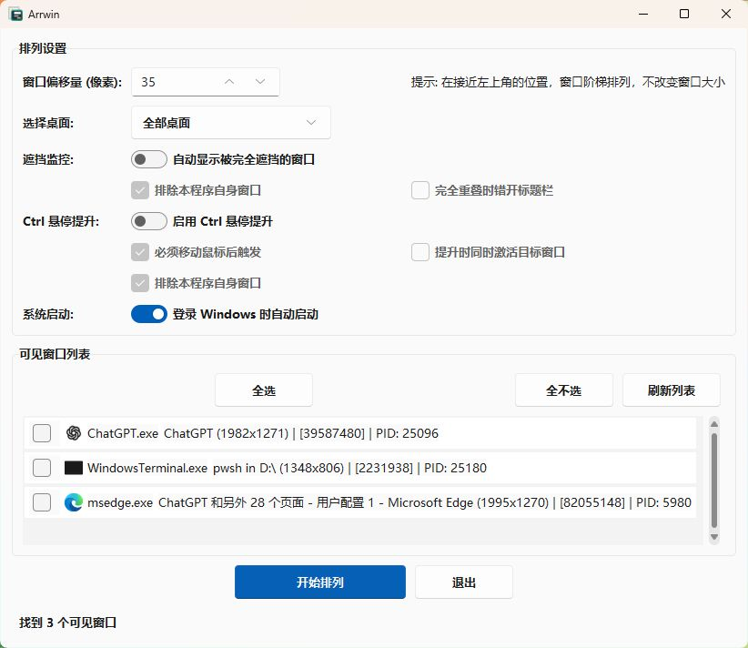

# Windows 窗口排列工具

一个简洁实用的 Windows 窗口自动排列工具，带有图形用户界面。

## 功能特性

- 📋 自动扫描并列出桌面所有可见窗口
- 🏷️ 显示窗口详细信息（句柄、标题、尺寸、PID、进程名、命令行）
- 🖼️ 显示每个窗口的程序图标
- ✅ 支持勾选/取消勾选要排列的窗口
- 🎛️ 可自定义窗口偏移量（10-200 像素）
- 🔄 支持刷新窗口列表
- 📐 阶梯式智能排列
- 👁️ 自动显示被其他窗口完全遮挡的普通窗口
- ↔️ 可选将完全重叠的窗口轻微错开，露出标题栏
- 🖱️ 按住 Ctrl 后移动鼠标，可将鼠标下的普通窗口提升到最前
- 💾 自动保存窗口大小和设置到可编辑的 `config.json`
- 🎨 现代化的 Tkinter 界面
- 📥 最小化或关闭时隐藏到系统托盘，后台监控继续运行
- 🚀 可选择登录 Windows 时自动启动，并静默驻留系统托盘

## 截图



程序会显示每个窗口的：
- 程序图标
- 进程名（蓝色醒目显示）
- 窗口标题和尺寸
- 窗口句柄和进程 PID
- 启动命令行（简短版本）

## 安装

1. 克隆或下载此项目
2. 安装依赖：

```bash
pip install -r requirements.txt
```

## 使用方法

### 方式一：直接运行 Python 脚本

```bash
python arrange_windows_gui.py
```

### 方式二：打包成 EXE

使用提供的批处理文件：

```bash
build_exe.bat
```

或手动打包：

```bash
pip install pyinstaller
pyinstaller --onefile --windowed --name="窗口排列工具" arrange_windows_gui.py
copy config.json dist\config.json
```

生成的 exe 和可编辑配置文件在 `dist` 目录中。

## 界面说明

### 1. 排列设置
- **窗口偏移量**：控制阶梯排列的间距（10-200 像素）
- 默认值：35 像素

### 2. 可见窗口列表
- 显示其他应用的所有可见窗口及其详细信息，始终排除本程序自身窗口
- 支持全选/全不选/刷新操作
- 每个窗口显示：
  - ✅ 复选框
  - 🖼️ 程序图标
  - 🔵 进程名（蓝色显示）
  - 📋 窗口标题、尺寸、句柄、PID
  - ⚪ 命令行参数（如果有）

### 3. 操作按钮
- **全选**：选中所有窗口
- **全不选**：取消选中所有窗口
- **刷新列表**：重新扫描窗口
- **开始排列**：执行窗口排列
- **退出**：停止后台监控并彻底退出程序

### 5. 系统托盘
- 点击窗口右上角的关闭按钮，或使用普通最小化按钮，程序会隐藏到 Windows 系统托盘。
- 双击托盘图标可以恢复主窗口。
- 右键托盘图标可选择 **打开主窗口** 或 **退出程序**。
- 只有选择 **退出程序** 或点击界面中的 **退出** 按钮才会停止后台监控。
- 为避免重复托盘图标，程序同一时间只允许运行一个实例。

### 6. 自动启动
- 在 **排列设置 → 系统启动** 中勾选 **登录 Windows 时自动启动** 后启用，默认关闭。
- 启动项只注册到当前 Windows 用户，不需要管理员权限。
- 自动启动时程序不会显示主窗口，而是等待约 20 秒后初始化窗口扫描和后台监控。
- Windows 11 任务管理器中的“启动应用”可以禁用或重新启用该启动项，程序会读取实际启用状态。
- 打包后的程序从新位置手动运行时会自动更新已有启动项中的可执行文件路径。
- 如果程序被移动后尚未从新位置运行过，旧启动项无法自行找到新路径，因此建议将程序安装在固定目录。

### 7. 遮挡监控
- 勾选 **自动显示被完全遮挡的窗口** 后，程序每秒检查一次当前桌面的普通窗口和对话框。
- 窗口被一个或多个上层窗口完全覆盖并持续 1 秒后，程序将其提升到普通窗口最前面。
- 顶层及带拥有者关系的对话框可以作为提升目标；工具窗口、不可激活窗口和置顶窗口不参与。
- 同一应用或同一 owner 组的弹层、阴影和辅助窗口不互相构成遮挡。
- 普通应用窗口满足 `IsZoomed` 最大化条件、通过 Windows 贴靠布局进入贴靠状态，或当前前台窗口按 `F11` 进入无边框全屏时，只暂停其所在显示器的自动提升；其他显示器仍会继续工作。
- 桌面、任务栏、工具窗口、不可激活窗口、置顶窗口和有拥有者关系的辅助窗口不会被识别为暂停触发源。
- 遮挡自动提升不会激活窗口，也不会设置永久置顶或改变窗口大小。
- 勾选 **完全重叠时错开标题栏** 后，尺寸和位置完全相同的非最大化窗口会轻微错开，避免互相循环遮挡。
- 监控只处理当前虚拟桌面；可通过 **排除本程序自身窗口** 控制本程序窗口是否参与扫描，默认排除。

### 8. Ctrl 悬停提升
- 勾选 **启用 Ctrl 悬停提升** 后启用。
- 可勾选 **必须移动鼠标后触发**，默认开启；关闭后按下 Ctrl 时即可尝试提升鼠标下的非激活窗口。
- 每次按下 Ctrl 最多提升一个窗口，不会永久置顶。
- 可勾选 **提升时同时激活目标窗口**，默认关闭；开启后会切换前台窗口，关闭时只改变窗口层级。
- 可勾选 **排除本程序自身窗口**，默认开启，控制本程序窗口是否参与悬停提升。
- 本次 Ctrl 会话成功提升过窗口后，松开 Ctrl 时会对当时的当前激活窗口执行一次提升；该窗口不一定与悬停目标相同。
- 遮挡自动提升始终不会激活窗口。
- 顶层对话框可以参与提升；带拥有者关系的对话框、置顶窗口、工具窗口、桌面和任务栏不会参与提升。
- 当前显示器存在最大化窗口、贴靠布局窗口，或当前前台窗口进入全屏时，暂停该显示器上的 Ctrl 悬停提升；其他显示器仍可提升。
- 某显示器在本次 Ctrl 会话中进入过暂停状态后，即使随后退出全屏，也需重新按下 Ctrl 才会在该显示器恢复触发。
- 鼠标下是当前激活窗口时不会提升；需在按住 Ctrl 期间移动到非激活窗口才会触发，直接松开 Ctrl 则不做任何操作。
- 底部状态栏显示最近一次提升的处理时间、窗口名称和实际耗时，可用于识别同一窗口频繁重复提升。

## 排列模式

窗口按照阶梯模式排列，从左下到右上分布：

```
窗口1 → 位置 (0, n*offset)
窗口2 → 位置 (offset, (n-1)*offset)
窗口3 → 位置 (2*offset, (n-2)*offset)
...
窗口n → 位置 ((n-1)*offset, offset)
```

**特点**：
- 阶梯排列，窗口不重叠
- 不改变窗口大小，只调整位置
- 在接近左上角的位置开始排列（留出适当边距）

## 配置保存

所有可持久化设置及默认值保存在程序目录的 `config.json`：
- 窗口宽度、高度和排列偏移量
- 遮挡监控、完全重叠错开和自身窗口排除
- Ctrl 悬停提升、必须移动触发、提升时激活和自身窗口排除
- 自动保存：界面修改设置或调整窗口大小时写回该文件
- 手动修改：关闭程序后编辑 `config.json`，下次启动生效
- 缺少配置项时自动使用内置默认值；JSON 格式错误时保留原文件并回退默认值

## 技术栈

- Python 3.x
- Tkinter - 图形界面
- pywin32 - Windows API 操作
- psutil - 进程信息获取
- Pillow - 图像处理（图标显示）
- pystray - Windows 系统托盘集成

## 系统要求

- Windows 11/10
- Python 3.7+
- 管理员权限（推荐，用于移动某些系统窗口）

## 注意事项

- 自动过滤全屏窗口和小窗口（小于 200x200 像素）
- 排列前会弹出确认对话框
- 只移动位置，不改变窗口大小
- 某些系统保护窗口可能无法移动

## 故障排除

如果无法移动某些窗口：
1. 以管理员身份运行程序
2. 确保窗口未处于最小化状态
3. 某些系统保护窗口可能无法移动

## 常见问题

**Q: 为什么看不到某些窗口？**
A: 程序会自动过滤全屏窗口和尺寸小于 200x200 像素的窗口。

**Q: 如何调整窗口过滤规则？**
A: 修改 `is_normal_window()` 函数中的过滤条件。

**Q: 配置保存在哪里？**
A: 配置保存在程序目录的 `config.json` 中，可直接用文本编辑器修改。

## 更新日志

### v1.0
- ✅ 基础窗口排列功能
- ✅ 图形用户界面
- ✅ 窗口信息显示（标题、尺寸、句柄）
- ✅ 进程信息显示（PID、进程名、命令行）
- ✅ 程序图标显示
- ✅ 注册表配置保存
- ✅ 窗口大小记忆

## 许可证

MIT License

## 贡献

欢迎提交 Issue 和 Pull Request！
